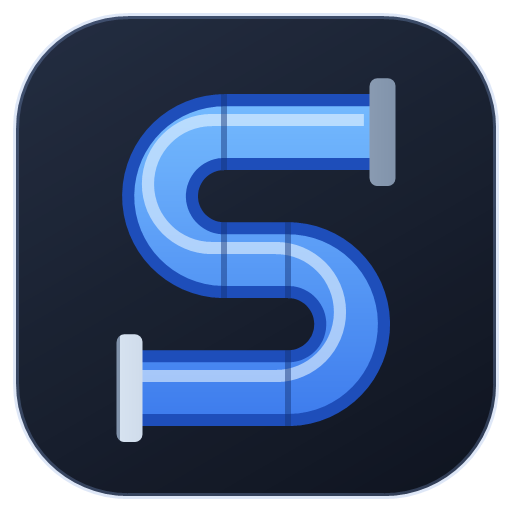
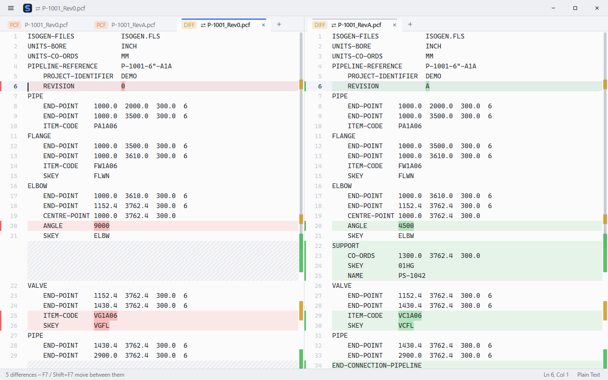
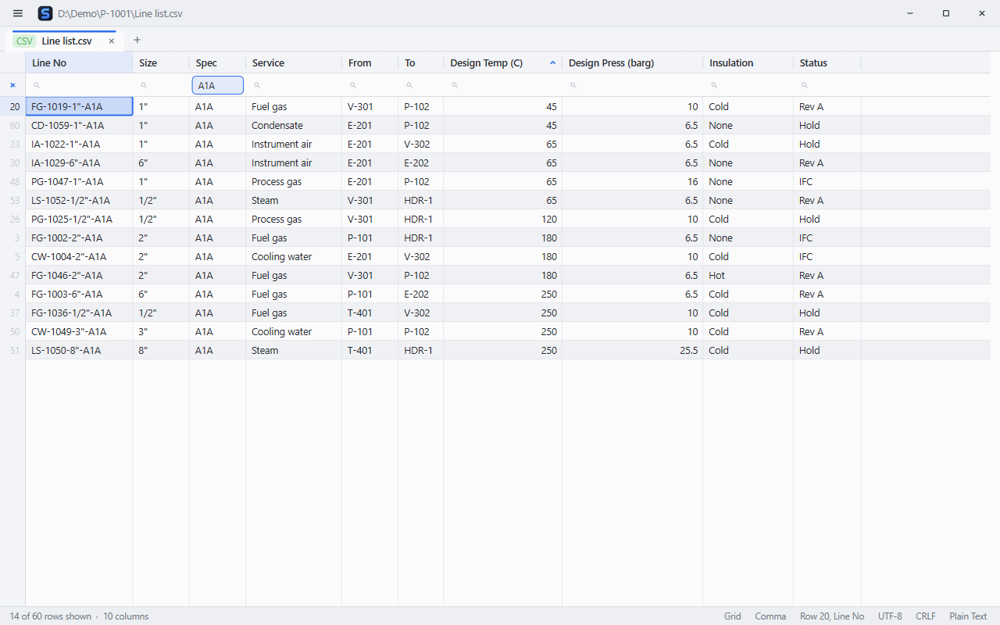
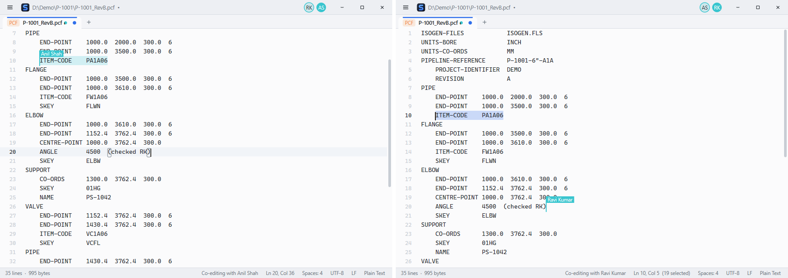
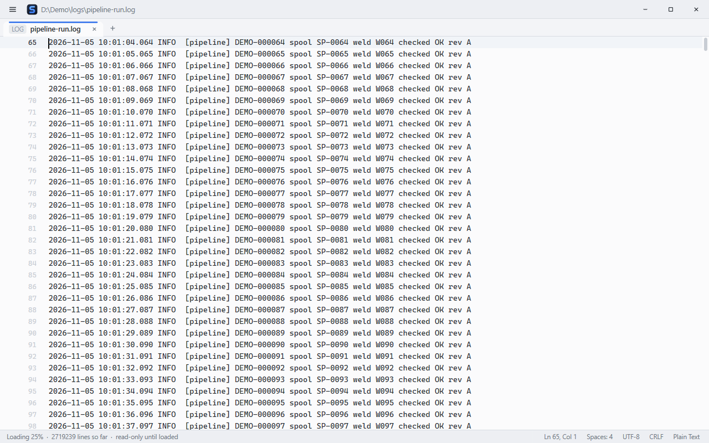
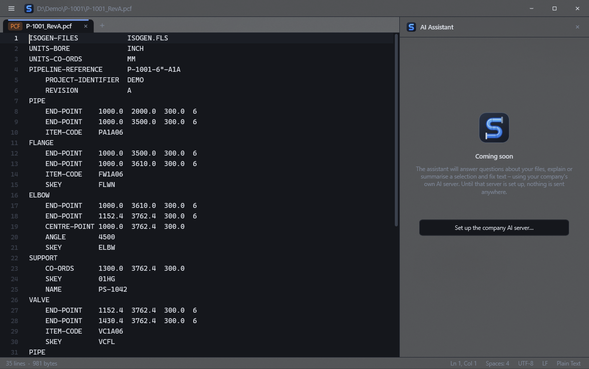

<p align="center"></p>

<h1 align="center">Slate</h1>

<p align="center"><b>A tiny, fast text editor for engineering work on Windows.</b><br>
The everyday Notepad++ feature set in one program of about 1 MB, with a CSV grid that pastes into
Excel as real columns, side-by-side revision compare, live co-editing over the office network and
files up to a gigabyte.</p>

<p align="center">
<a href="https://github.com/dexterity-admin/slate/releases/latest"><b>Download for Windows</b></a> ·
<a href="https://dexterity-admin.github.io/slate/">Website</a> ·
<a href="#keyboard-shortcuts-notepad-layout-where-it-has-one">Shortcuts</a>
</p>

<p align="center"></p>

- **Installs per user, no admin rights** (or use the portable zip), and keeps itself up to date:
  signed releases, and a failed update puts the previous version back.
- **Zero CPU when idle** – nothing animates unless it moves, and the caret blinks without repaints.
- **Direct2D everywhere** – light and dark themes, seven accents, smooth scrolling, gliding tabs,
  file-type badges, an optional translucent window.

| | |
|---|---|
|  **CSV grid** – filter, sort and edit registers; copy to Excel as columns |  **Co-editing** – two people, one file, named carets, no server |
|  **Big files** – a 1 GB log shows at once and searches in a second |  **Dark theme, acrylic** – and an AI panel for your own server |

## Measured against Notepad++ (same machine, same files)

`tools\bench.ps1`; `WorkingSet64` and `PrivateMemorySize64` from `Get-Process` after 26 s; idle CPU = %
of one core over 16–26 s after launch; startup CPU = CPU time used in the first 4 s. Slate 1.5.0
with team features on, Notepad++ 8.x, November 2026.

| | WorkingSet64 | PrivateMemorySize64 | Startup CPU | Idle CPU |
|---|---|---|---|---|
| Slate, empty | **25.6 MB** | 33.4 MB | **781 ms** | **0 %** |
| Notepad++, empty | 46.8 MB | 31.0 MB | 906 ms | 0.31 % |
| Slate, 2 MB file | **28.3 MB** | 36.0 MB | **844 ms** | **0 %** |
| Notepad++, 2 MB file | 51.8 MB | 35.6 MB | 984 ms | 1.09 % |
| Slate, 10 MB file | **38.6 MB** | **45.2 MB** | **1,062 ms** | **0 %** |
| Notepad++, 10 MB file | 70.6 MB | 54.4 MB | 2,500 ms | 0.31 % |
| Executable size | **1.0 MB** | | | |
| notepad++.exe / full install | 8.47 MB / 31 MB | | | |

Private memory on an empty window (~33 MB) is the Direct2D/GPU floor that was accepted when
Direct2D was chosen; it is level with Notepad++ and Slate pulls ahead as files grow. A 1 GB file
takes about its own size in memory.

## Features

**Files** – open (multi-select dialog, drag-and-drop, command line), save / save as / save all,
recent files, reopen closed tab, reload, external-change detection (clean files reload silently,
modified ones ask), show in Explorer, copy path. A second `slate.exe <file>` hands the file to the
running window.

**Session** – tabs, carets, scroll positions, bookmarks and *unsaved* text are restored on the next
start. Unsaved buffers are backed up every 8 s after an edit, so a crash loses at most a few
seconds. Stored in `%APPDATA%\Slate\` (`settings.ini`, `session.ini`, `backup\`).

**Editing** – undo/redo (typing coalesced), cut/copy/paste (whole line when nothing is selected),
multiple carets (Ctrl+click, Ctrl+E next occurrence, Ctrl+Alt+Up/Down), column selection
(Alt+drag, Alt+Shift+arrows) with column copy/paste, overtype, auto-indent, smart Home,
Tab/Shift+Tab indent, toggle/add/remove line comments, duplicate, delete and move lines, join,
upper/lower/title case, sort, de-duplicate, reverse, trim trailing whitespace, tabs↔spaces,
go to matching brace, macro record and playback.

**Search** – find panel with match count, match case, whole word, regular expressions
(`$1` references in replacements), replace / replace all, find in files with folder and filters
(results open in a tab; Enter or double-click jumps to the hit), go to line[:column], and
same-word highlighting of the current selection.

**View** – tabs (drag to reorder, middle-click to close, drag onto the other view to move), split
view (move or clone a tab to the other side, draggable divider), word wrap, zoom
(Ctrl+wheel), whitespace and line-end markers, bookmarks with scrollbar ticks, code folding,
bracket matching, current-line highlight.

**Documents** – syntax highlighting for 21 languages (C/C++, C#, Java/Kotlin, JS/TS, Rust, Go,
Python, PowerShell, Batch, Shell, SQL, JSON, XML/HTML, CSS, INI/TOML, YAML, Markdown, Lua, PHP,
Visual Basic, plain text); encodings UTF-8, UTF-8 BOM, UTF-16 LE/BE and ANSI with detection,
convert-on-save and reopen-with-encoding; line endings CRLF/LF/CR, preserved on save.

## CSV grid

`.csv`, `.tsv` and `.tab` files open as a table (Ctrl+Shift+G switches between grid and text; the
status bar shows which, and the delimiter). The delimiter (comma, tab, semicolon or pipe) is
detected and can be changed. Quoted fields, commas inside quotes, line breaks inside a cell, and
inch marks such as `6" PIPE` are all read correctly.

- **Filter** – a box under each column header. Text matches anywhere in the cell, ignoring case;
  `=A1A` matches the whole value, `!vent` excludes, `>100`, `<=6.5` compare numbers. Filters
  combine. Ctrl+F types into the current column's filter; the × at the left clears them all.
- **Sort** – the arrow at the right of a header: ascending, descending, off. Numbers sort as
  numbers, blanks stay last. Sorting and filtering only change the view, never the file.
- **Select** – click and drag cells, click a header for whole columns or a row number for whole
  rows, Shift to extend, Ctrl+A for everything. Arrows, Tab, Enter, Page Up/Down, Ctrl+arrows and
  Ctrl+Home/End move as in a spreadsheet.
- **Copy to Excel** – Ctrl+C puts the cells on the clipboard as tab-separated text plus Excel's own
  format, so they paste as **separate columns**. Values stay exactly as in the file: `0012` stays
  `0012`, `1-2` does not become a date, numbers stay numbers. Whole-column copies include the
  header. Copying CSV text from the *text* view pastes into Excel as columns too, while other
  editors still receive the original comma-separated text.
- **Edit** – type over a cell, or F2 / double-click to edit it; Enter or Tab commits, Esc cancels.
  Delete clears the selection; Ctrl+V pastes from Excel (one value pasted over a block fills it,
  rows past the end are added). Only the changed records are rewritten, untouched fields keep their
  exact bytes, and every edit is one undo step.
- **Columns** – drag a header edge to resize, double-click it to fit.
- Large files: a 66 MB, 1,000,000-row file opens in the grid in about a second, filters in about
  half a second and adds roughly 12 MB of memory over the file itself.

## Compare

Ctrl+Alt+C compares two files side by side, line by line, for checking one revision against
another (Rev 0 against Rev A).

- With both split views showing a file, it compares those two. Otherwise it asks what to compare
  the current file with: another open tab, a file on disk, or the file's own saved version when
  it has unsaved changes. The other file goes on the left and the current one on the right;
  **Compare: Swap Sides** turns them round.
- Lines that differ are tinted (red on the left, green on the right) with the changed words
  marked inside them. Added or removed lines face a hatched gap on the other side, so the two
  sides always stay level and scroll together. Line numbers are those of the files.
- F7 / Shift+F7 jump to the next / previous difference; the scrollbars show where they all are.
  The status bar counts changed, added and removed lines.
- **Compare: Toggle Ignore Whitespace** and **Toggle Ignore Case** hide cosmetic changes.
- The compare is read-only. Edit the file in its own tab, then F5 refreshes the compare.
  Ctrl+Alt+C again (or closing either side) closes it.
- Large files: two 1,000,000-line files compare in about two seconds.

## Team features

Slates on the same network **find each other by themselves** and talk directly – there is nothing
to set up and no server to run. Your name comes from Windows (**Team: Set Your Display Name** can
change it). **Settings: Toggle Team Features (LAN)** turns it all off.

- **Who's online** – avatars in the title bar; click them to see who has which file open and open
  it. Tabs show a coloured dot for each colleague who has the same file open (solid when they have
  unsaved changes), and the status bar names them.
- **Warnings** – opening a file a colleague has open, or starting to change one they have unsaved
  changes in, says so.
- **Locks** – **Team: Lock / Unlock This File** makes the file read-only for everyone else until
  you unlock it or close it.
- **Co-editing** – Ctrl+Shift+E on a shared file starts co-editing; colleagues who have it open are
  offered to join with the same key. Everyone types at once and sees the others' named carets and
  selections; anyone can save. One participant puts the changes in order and everyone keeps the
  ordered history, so when that person leaves or their PC drops off, the others choose a new one,
  catch up and resend whatever was not confirmed – nothing typed is lost. Undo takes back only your
  own changes, wherever the others typed.
- **Library** – snippets, shared macros and find / replace presets (**Library:** commands insert,
  run, use, save and delete them). Every PC keeps a copy and the copies sync: the newest version of
  each item wins, and deletions travel too.
- **Instant search** (Ctrl+Shift+I) – file names and text across the project folders, results like
  Find in Files. One always-on PC runs `slate.exe --hub "\\server\projects\P-1001" ...` (for example
  from Task Scheduler at log-on); it indexes those folders on its own disk, re-reads only changed
  files every 10 minutes and answers every Slate's searches.

How it connects: each Slate announces itself on UDP port 47613 (multicast and broadcast) and keeps
one TCP connection to each other Slate, on a port Windows picks. The first time, Windows Firewall
may ask whether Slate may use the network: allowing it on private networks lets colleagues connect
to you; if it is not allowed you can still connect to them. Mapped drive letters are translated to
their `\\server\share` paths, so everyone names a file the same way.

## Big files

Files over 16 MB stream in: the first screen shows within a second and you can read and scroll while
the rest arrives (read-only until it has); a 1 GB file takes about 10–15 s to read from a hard disk.
Plain-text search runs through a gigabyte in about a second; a regular expression searches a huge
file 64 MB at a time. Huge files (64 MB and up) save in the background, through a temporary file
when the disk has room, and skip syntax colouring, crash backups and live match counts.

**Follow mode** (Ctrl+Shift+W, or **Follow** in the status bar of a `.log`) shows a log's new lines
as they are written, keeping to the end unless you scroll up; a rotated or truncated log reloads.

## AI assistant

**View: AI Assistant Panel** (Ctrl+Shift+A) – ask about the file or the selection, or use *Explain*,
*Summarise* and *Fix / rewrite*, then insert or copy the answer. It talks only to your company's own
AI server (**AI: Set Company AI Server**, e.g. `http://ai-server:11434`; anything that offers the
common chat-completions interface, such as Ollama, vLLM or LiteLLM). Until a server is set the panel
says *Coming soon* and nothing is sent anywhere.

## Appearance

Light and dark themes, seven accent colours (**View: Accent Colour**), and **View: Toggle
Translucent Window (Acrylic)** for a frosted title bar, tab strip and status bar (the editor stays
solid). A short splash with the logo shows when Slate opens or receives files.

Everything is reachable from the **command palette** (Ctrl+Shift+P, F1 or the ≡ button), which
also lists each shortcut. Status-bar items are clickable (line → go to line, encoding, line
ending, language, tab width, zoom, wrap).

## Keyboard shortcuts (Notepad++ layout where it has one)

| | |
|---|---|
| Ctrl+N / O / S | New / Open / Save |
| Ctrl+Alt+S / Ctrl+Shift+S | Save as / Save all |
| Ctrl+W, Ctrl+Shift+T | Close tab, reopen closed tab |
| Ctrl+Tab, Ctrl+PgUp/PgDn | Switch tabs |
| Ctrl+P, Ctrl+Shift+O | Go to open tab, open recent |
| Ctrl+Shift+P, F1 | Command palette |
| Ctrl+F / H / Shift+F | Find / Replace / Find in files |
| F3 / Shift+F3 | Find next / previous |
| Alt+C / Alt+W / Alt+R | (in find panel) match case / whole word / regex |
| Ctrl+G, Ctrl+B | Go to line, matching brace |
| Ctrl+D, Ctrl+Shift+L | Duplicate, delete line |
| Ctrl+Shift+Up/Down | Move line(s) |
| Ctrl+Q or Ctrl+/ | Toggle comment (Ctrl+K add, Ctrl+Shift+K remove) |
| Ctrl+J | Join lines |
| Ctrl+U / Ctrl+Shift+U | lowercase / UPPERCASE |
| Ctrl+E | Add next occurrence |
| Ctrl+Alt+Up/Down | Add caret above/below |
| Alt+Shift+arrows, Alt+drag | Column selection |
| Ctrl+F2, F2, Shift+F2 | Toggle / next / previous bookmark |
| Alt+0, Alt+Shift+0, Ctrl+Alt+F | Fold all, unfold all, toggle fold |
| Alt+Z | Word wrap |
| Ctrl+= / Ctrl+- / Ctrl+0 | Zoom in / out / reset |
| F8 | Focus other view |
| Ctrl+Shift+R / Ctrl+Shift+M | Record / play macro |
| Ctrl+Shift+G | CSV grid / text view |
| Ctrl+Alt+C | Compare with… / close compare |
| F7 / Shift+F7, F5 | Next / previous difference, refresh compare |
| Ctrl+Shift+E | Co-edit this file (start / join / leave) |
| Ctrl+Shift+I | Instant search (through the search hub) |
| Ctrl+Shift+W | Follow the file as it grows (tail) |
| Ctrl+Shift+A | AI assistant panel |
| Insert | Overtype |

## Command line

```
slate.exe [files...] [-multiInst] [-nosession]
```

`-multiInst` starts a separate window instead of handing files to the running one;
`-nosession` neither restores nor saves the session or backups.
`slate.exe <file> <milliseconds>` is benchmark mode (closes itself, touches no settings).
`slate.exe --hub <folder> [<folder> ...] [--once]` runs the search hub: no window, indexes the
folders every 10 minutes and answers searches (the folders are remembered; `--once` runs one pass).

## Known limits

- Only the first 32 KB of a single line is drawn (minified files with one giant line).
- Files that mix line-ending styles are unified to the dominant style when saved; the status bar
  shows "(mixed)" and a message says so on open.
- Folding follows indentation (plus Allman `{` lines), not a full parser.
- Not included, by agreement: Notepad++ plugins, function list, document map, printing,
  localization.
- The compare view is read-only, does not wrap lines and does not fold; it compares files of up
  to 256 MB each.
- Co-editing works on files up to 128 MB. If the network splits a session in two and both halves
  carry on, the half with fewer changes reloads the other's text when they meet again.
- Instant search is literal text (no regular expressions through the index) and checks at most
  3,000 candidate files per search.
- Unsaved changes in huge files are not backed up while you work; closing Slate asks about them.
- The grid cannot add rows to an empty table or insert columns; use the text view (or paste rows
  past the end).
- Context menus, file dialogs and message boxes are the native Windows ones.
- Files up to 4 GB.

## Building

Rust (MSVC toolchain) and the Windows SDK. `build.rs` compiles `res\slate.rc` (icon, manifest,
version info) with the SDK's `rc.exe`.

```
cargo build --release
cargo test --release
```

Source layout: `doc.rs` gap buffer + line index · `buffer.rs` selections, undo, folds, bookmarks ·
`edit.rs` text commands · `csv.rs` table index, filters, sort, Excel clipboard formats ·
`grid.rs` the grid view · `diff.rs` line diff and alignment · `compare.rs` the compare view ·
`net.rs` + `wire.rs` LAN discovery, connections and messages · `team.rs` presence and locks ·
`ot.rs` + `collab.rs` co-editing · `library.rs` team library · `index.rs` search index and hub ·
`follow.rs` follow mode · `ai.rs` assistant panel ·
`syntax.rs` lexers · `enc.rs` encodings · `search.rs` find / find in
files · `app.rs` tabs, views, commands, session · `view.rs` layout cache and scrolling ·
`paint.rs` rendering · `input.rs` keyboard and mouse · `ui.rs` chrome geometry · `gfx.rs`
Direct2D resources · `sys.rs` clipboard, dialogs · `main.rs` window and message loop.

Test tools: `tools\drive.ps1` drives a live window and takes screenshots; `tools\duo.ps1` drives two
windows as two team members on the LAN; `tools\bigfile.ps1` times opening, searching and saving a
big file; `tools\rollback-test.ps1` runs crash, hang and good updates through the real updater;
`tools\bench.ps1` produces the table above. The website is `docs\index.html` (GitHub Pages).
